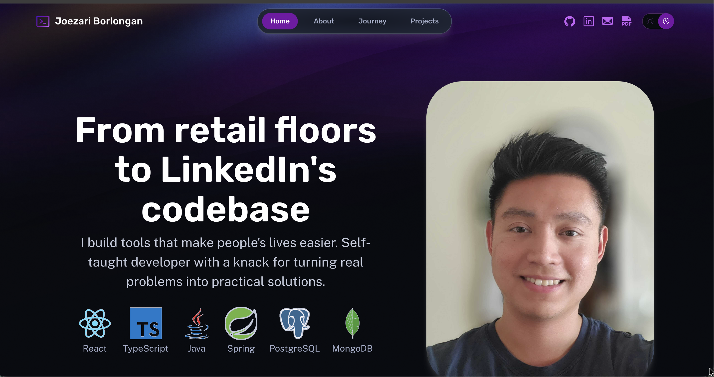

# Portfolio

My personal portfolio showcasing projects and my journey from retail to software engineering.

**Live:** [portfolio.joe-bor.me](https://portfolio.joe-bor.me)



## Features

- **View Transitions** - Smooth page navigation with image morphing
- **Scroll-driven animations** - Elements reveal on scroll (CSS + JS fallback)
- **Staggered hero animation** - Tagline animates word-by-word on first visit
- **Dark/light theme** - Toggle with localStorage persistence
- **Responsive design** - Mobile-first approach
- **Reduced motion support** - Respects user accessibility preferences

## Tech Stack

- [Astro](https://astro.build/) - Static site generator
- TypeScript
- CSS (View Transitions API, scroll-driven animations)
- [Netlify](https://www.netlify.com/) - Hosting

## Run Locally

```bash
npm install
npm run dev
```

Opens at `localhost:4321`
